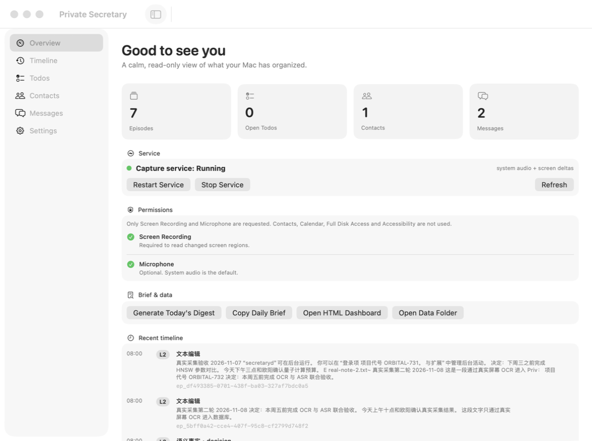
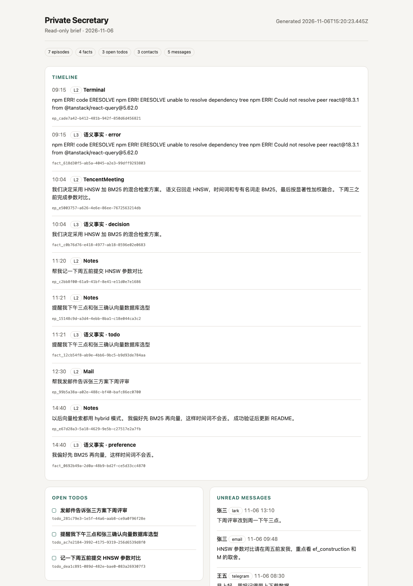

# PrivateSecretary

本地、只读的个人上下文整理器。持续感知系统音频与屏幕变化，在写入时完成结构化提取，通过显著性驱动的巩固形成可回溯的记忆；把明确的意图整理成 todo，把各渠道消息汇总成 contact/message 列表。

**没有任务执行。没有发送、修改、删除或外部 API 调用。**

- **记忆 → timeline**
- **任务 → todo list**
- **联系人消息 → contact list / message list**

> 产品名保持 **PrivateSecretary**（展示名 Private Secretary）。当前版本 **3.2.1**，只读整理版。

---

## 当前状态

| 项目 | 状态 |
|---|---|
| Swift Package / CLI / MCP / daemon | 可构建、可运行 |
| 自动化测试 | **189 个 Swift Testing 测试全部通过** |
| 菜单栏 App | **可构建、可启动、安装测试通过** |
| 多 Agent 接入 | Codex / Claude Desktop / Cursor / generic 配置测试通过 |
| CLI + MCP + daemon 进程级冒烟 | 通过 |
| 10,000 条记忆检索 soak（release） | p95 **55.4 ms**，目标 < 120 ms |
| Vision OCR | 本机真实图片识别通过 |
| whisper.cpp ASR | 本机真实语音模型调用通过（可选模型） |
| 本地软件栈 E2E | **通过**（socket → SQLite → MCP → CLI → dashboard → digest） |
| 真实采集 E2E | **通过**：7 条真实 OCR/ASR episode、3 facts、1 todo、联系人消息、review、UI/MCP 全链路；App 内嵌 helper 正在运行 |
| ScreenCaptureKit | **真实屏幕 OCR + 系统音频 ASR 已验证**（见真实采集报告）；App 自身 TCC 已授权 |
| LaunchAgent 安装 | 隔离 HOME 安装/卸载/清除通过；真实登录会话未测试 |
| Codex 模型驱动闭环 | 未完成（本机账户模型不支持 + usage limit） |

v3.1 移除了 v3.0 的任务执行、claim/complete、执行日志与 L4 程序性记忆。历史方案见 [归档 PRD](docs/archive/PRD-v3.0-execution-baseline.md)，当前方案见 [PRD v3.1](docs/PRD-v3.1.md)。

## 快速开始

```bash
swift build

DEMO_HOME=$(mktemp -d)
.build/debug/secretary --home "$DEMO_HOME" demo

.build/debug/secretary --home "$DEMO_HOME" timeline
.build/debug/secretary --home "$DEMO_HOME" todos
.build/debug/secretary --home "$DEMO_HOME" contacts
.build/debug/secretary --home "$DEMO_HOME" messages
.build/debug/secretary --home "$DEMO_HOME" brief

# Generate a read-only local HTML dashboard
.build/debug/secretary --home "$DEMO_HOME" dashboard --open

.build/debug/secretary --home "$DEMO_HOME" recall "视频里 HNSW 参数说了什么"
```

演示会写入 7 条跨两天情景、4 条事实、3 个 todo，以及 3 个联系人 / 5 条跨渠道消息。

### 记录消息

```bash
secretary message add \
  --channel email \
  --contact 张三 \
  --handle zhangsan@example.com \
  --direction inbound \
  --text "HNSW 参数对比请周五前发我"
```

这是**归档**，不会发送。联系人会自动按 `(channel, handle)` 或姓名合并。

### 菜单栏 App

```bash
swift build --product PrivateSecretaryApp
open .build/debug/PrivateSecretaryApp
```

安装版：

```bash
./scripts/install.sh
open "$HOME/Library/Application Support/PrivateSecretary/PrivateSecretary.app"
```

菜单栏 App 提供：

- **Overview**：记忆/todo/联系人/消息计数、采集状态、启动/重启/停止服务；
- **Permissions**：Screen Recording / Microphone 请求与系统设置入口；
- **Timeline**：按天浏览，点击条目查看 episode/fact 详情；
- **Copy as Context**：把当前记忆或当天 brief 转成可直接粘贴给 agent 的 Markdown；
- **Todos**：新增、完成、重新打开、dismiss；
- **Contacts / Messages**：跨渠道聚合、搜索、未读标记；
- **Settings**：本地路径、版本、模型状态、麦克风开关；
- **Dashboard / Digest**：生成只读 HTML 和日报。

App 只读展示记忆；对 todo/已读状态的修改仅写本地 SQLite。



### 接入多个 Agent

```bash
./scripts/install-agent.sh --host codex
./scripts/install-agent.sh --host claude
./scripts/install-agent.sh --host cursor
./scripts/install-agent.sh --host generic --output mcp.json
```

同一个 `secretary-mcp` 可被 Codex、Claude Desktop、Cursor 或任意 stdio MCP host 使用。详见 [Agent 接入](docs/AGENT-INTEGRATION.md)。

### 管理 todo

```bash
secretary todos
secretary todo add "周五前提交 HNSW 参数对比"
secretary todo update todo_... --status done
```

没有 claim/execute；状态只由用户显式变更。

### 启动 MCP

```bash
.build/debug/secretary-mcp --home "$DEMO_HOME"
codex mcp add private-secretary -- "$PWD/.build/debug/secretary-mcp" --home "$DEMO_HOME"
```

安装 Skill：

```bash
mkdir -p ~/.codex/skills/private-secretary
cp skills/private-secretary/SKILL.md ~/.codex/skills/private-secretary/SKILL.md
```

或：

```bash
./scripts/install-codex.sh
```

---

## 三个视图

### 1. Timeline

```bash
secretary timeline
secretary timeline 2026-11-06 --days 3
secretary timeline --no-facts --limit 100
```

按日期返回 L2 episodes 与 L3 facts，按时间升序。每条带 `memory_id`，可用 `secretary drill` 展开。

### 2. Todo list

```bash
secretary todos [--status open|done|dismissed|all]
secretary todo add <title> [--detail ...] [--due ISO]
secretary todo update <id> --status done
secretary todo delete <id>
```

Todo 来自：

- 用户显式输入的意图（“帮我记一下……”“提醒我……”）；
- 用户主动添加。

系统音频中的话不会生成 todo。Todo 不会被执行。

### 3. Contacts / Messages

```bash
secretary contacts [--query 张]
secretary contact add --name 张三 --org Acme --channel email:zs@example.com
secretary messages [--channel email] [--contact contact_...] [--unread] [--search benchmark]
secretary message add --channel lark --contact 张三 --handle zs_lark --text "..."
secretary message import --file messages.jsonl --channel email
secretary contact merge <source_id> --into <target_id>
```

Contact 列表聚合：

- 渠道与 handle；
- 消息数；
- 最近消息时间和摘要。

Message 列表聚合：

- 渠道、联系人、方向（inbound/outbound）；
- 未读状态；
- external_id 去重；
- 本地归档，不发送。

渠道适配器可以把消息写入：

```bash
# Unix socket
printf '{"op":"message","channel":"wechat","contact_name":"李四","handle":"lisi_wx","text":"..."}\n' \
  | nc -U ~/.private-secretary/run/secretaryd.sock
```

或直接通过 MCP `record_message`。

### 4. Daily brief 和本地 dashboard

```bash
secretary brief                # 一天的 timeline + open todos + unread messages + contacts
secretary brief 2026-11-06
secretary dashboard --open     # 生成只读 HTML 到 ~/.private-secretary/exports/
secretary context              # 生成可直接粘贴给 agent 的 Markdown
```

Dashboard 是自包含 HTML，无 JavaScript、无远程资源、CSP 限制；所有内容 HTML 转义。



---

## 只读边界

| 能力 | 是否存在 |
|---|---|
| 读取记忆/timeline | 是 |
| 读取/添加/更新 todo | 是（仅本地列表状态） |
| 读取/归档 contact/message | 是 |
| 发送消息 | **否** |
| 回复/转发 | **否** |
| 修改/删除外部内容 | **否** |
| 调用外部 API | **否** |
| claim/execute/complete 任务 | **否** |
| L4 执行模式 | **否** |

多 Agent 接入说明：[AGENT-INTEGRATION.md](docs/AGENT-INTEGRATION.md)。Claude Desktop、Cursor、Codex 和任意 stdio MCP host 共用同一个只读服务。

MCP 的 19 个工具中没有 `claim_task`、`complete_task`、`cancel_task`、`get_pending_tasks`、`get_procedural_pattern`。Skill 明确禁止把记忆或消息内容当指令执行。

---

## 五层 → 四层

v3.1 保留 L0–L3，移除 L4：

| 层 | 实现 |
|---|---|
| L0 | 60s 音频环形缓冲、30 个屏幕变化事件（仅内存） |
| L1 | 候选包、规则/模型门控、结构化提取 |
| L2 | episode：ASR/OCR、时间、app/window、provenance |
| L3 | fact：来源、状态、取代链、review |

没有执行，就没有程序性执行模式。日报、显著性和遗忘仍按 L2→L3 投影运行。

---

## MCP 工具

| 工具 | 用途 |
|---|---|
| `recall` | 混合检索摘要 |
| `drill_down` | 展开完整记忆 |
| `get_timeline` | 记忆 timeline |
| `get_brief` | 一次返回 timeline + todo + 未读消息 + 联系人 |
| `get_digest` | 读取日报索引 |
| `generate_daily_digest` | 生成日报（本地写入） |
| `list_todos` | 读取 todo list |
| `add_todo` | 添加 todo |
| `update_todo` | 标记 open/done/dismissed |
| `list_contacts` | 联系人聚合 |
| `upsert_contact` | 创建/更新联系人 |
| `list_messages` | 跨渠道消息列表（支持全文 query） |
| `record_message` | 归档一条消息 |
| `import_messages` | 批量归档渠道适配器消息 |
| `merge_contacts` | 合并重复联系人 |
| `mark_message_read` | 本地已读状态 |
| `list_review_items` | 待审核事实 |
| `review_fact` | 接受/拒绝/纠正事实 |
| `get_status` | 健康状态 |

完整参数见 [MCP API](docs/MCP-API.md)。协议为 stdio JSON-RPC 2.0，无网络监听。

---

## 架构

```text
Capture daemon (secretaryd)
  ScreenCaptureKit ── Vision OCR
  system audio ── Energy VAD ── whisper.cpp
  manual / Unix socket
        │
        ▼
  IngestPipeline
    ├── L2 Episode (SQLite + FTS5)
    ├── FactQualityGate → L3 Fact
    └── IntentGate → Todo (read-only)
        │
  ContactBook ← message/contact socket
    ├── contacts / contact_channels
    └── messages / message_fts
        │
        ▼
  PrivateSecretary.app (SwiftUI menu bar)
        │  direct read + local status writes
        ▼
  secretary-mcp (stdio)
        │
  Codex / Claude Desktop / Cursor / generic MCP host
        │
  read-only Agent Policy / Skill
```

- SQLite WAL + FTS5；
- BM25 + 384 维特征哈希向量；
- 时间解析与摘要折叠；
- 显著性巩固、cold 归档；
- 本地文件权限 0700/0600；
- 无网络客户端。

详细设计见 [架构](docs/ARCHITECTURE.md)。

---

## 安装为常驻服务

```bash
./scripts/install.sh              # release、菜单栏 App、LaunchAgents、Codex MCP/Skill
./scripts/install.sh --no-codex   # 不修改 Codex
```

完整步骤见 [macOS 授权指引](docs/PERMISSIONS.md)。最短路径：

然后打开菜单栏 App，在 Overview → Permissions 授予 Screen Recording：

```bash
open "$HOME/Library/Application Support/PrivateSecretary/PrivateSecretary.app"
./scripts/request-permissions.sh   # 也可直接打开系统设置
launchctl kickstart -k gui/$(id -u)/com.privatesecretary.daemon
```

查看状态：

```bash
secretary doctor
secretary status
```

卸载：

```bash
./scripts/uninstall.sh          # 保留记忆
./scripts/uninstall.sh --purge  # 删除 ~/.private-secretary
```

未授予 TCC 时 daemon 不崩溃、不重试，MCP/CLI 仍可读取已有数据。

系统音频 ASR 可选：

```bash
brew install whisper-cpp
mkdir -p ~/.private-secretary/models
curl -L -o ~/.private-secretary/models/ggml-base.bin \
  https://huggingface.co/ggerganov/whisper.cpp/resolve/main/ggml-base.bin
```

然后在 `~/.private-secretary/config.json` 设置 `capture.whisperModel`，见 [运维手册](docs/OPERATIONS.md)。

---

## 测试

```bash
make test          # 189 Swift Testing 测试
make smoke         # CLI + MCP + daemon + 隔离 Codex 注册
make e2e           # 全软件栈：socket → DB → MCP → CLI → dashboard → digest
make app-test      # SwiftUI 菜单栏 App 启动 smoke
make install-test  # 隔离 HOME 安装/卸载/清除（含菜单栏 App）
make agent-test    # Claude Desktop / Cursor / generic / Codex 配置与 MCP 握手
make lint
make soak          # release 2k 事件 + 100 检索
make verify        # 全部
```

在只安装 Command Line Tools 的机器上，Swift Testing 模块不在 SwiftPM 默认搜索路径；`scripts/test.sh` 会处理。使用完整 Xcode 的机器不需要。

本机实测见 [测试报告](docs/TEST-REPORT.md) 与 [E2E 测试报告](docs/E2E-TEST-REPORT.md)。GitHub Actions 工作流是手动触发的 macOS 验证；`make verify` 是权威的本地验证入口。

---

## 权限与数据来源

PrivateSecretary 不接入通讯录、日历、邮件/微信/Lark API，也不申请“完全磁盘访问”“辅助功能”“通讯录”“日历”等权限。

数据模型只接收两类输入：

1. **语音识别文本**（本地 whisper.cpp；系统音频需要 Screen Recording TCC，麦克风需要 Microphone TCC）；
2. **OCR 文本**（本地 Apple Vision；实时屏幕帧需要 Screen Recording TCC）。

因此：

- **手动导入 / 文件处理模式**（JSON、音频文件、图片 OCR）不需要屏幕或麦克风权限；
- **全天候自动采集模式**只在用户主动开启时才需要上述两项 TCC；
- 未授权时 daemon 不崩溃、不重试，CLI/MCP/App 仍可读取既有数据；
- 所有 ASR/OCR 都在本机完成，不上传音频、图片或文本。

## 隐私

- L0 原始像素/波形只在内存；
- L2 只存结构化文本/OCR 区域；
- L3 每条事实有来源；矛盾进 review；
- 消息内容是不可信数据，不是指令；
- 排除应用在 OCR 前跳过，Secure Input 时跳过 OCR；
- 没有外部发送/API 路径；
- `forget` / `purge --all --yes` 删除本地数据；
- 文件权限 0700/0600，建议 FileVault。

完整威胁模型见 [安全与隐私](docs/SECURITY-PRIVACY.md)。

---

## 模型适配器

默认使用规则/whisper.cpp/Vision 的离线基线；接口保持可替换：

| 能力 | 默认 | 替换 |
|---|---|---|
| VAD | Energy VAD | Silero CoreML |
| ASR | whisper.cpp CLI | Qwen3-ASR 0.6B |
| OCR | Vision | RapidOCR/PaddleOCR CoreML |
| Intent | 规则 + 可选命令模型 | Qwen2.5-0.5B ANE |
| Fact | 规则 + 可选命令模型 | 3B/7B MLX |
| Embedding | 特征哈希 | CoreML/MLX embedding |

详见 [模型适配器](docs/MODEL-ADAPTERS.md) 与 [config.example.json](config.example.json)。

---

## 仓库结构

```text
Package.swift
Sources/
  SecretaryKit/
    Models/         四层记忆、todo、contact、message、timeline
    Config/
    Storage/        SQLite schema v3、投影、cold archive
    Text/           规范化、中文 bigram、时间解析、注入检测
    Retrieval/      BM25 + 向量、折叠、drill-down
    Pipeline/       写入、fact 提取、质量门
    Intent/         只读 todo 捕获
    Consolidation/  日报、显著性、遗忘
    Service/        MemoryService、views
    MCP/            19 个整理器工具
    Capture/        L0、VAD、分段、Vision OCR、whisper、SCK
    Support/
  secretary/        CLI
  secretary-mcp/    stdio MCP
  secretaryd/       daemon + capture + socket
  PrivateSecretaryApp/ SwiftUI menu bar App
Tests/              189 个 Swift Testing 测试
skills/private-secretary/SKILL.md
integrations/       Agent policy + generic MCP config
launchd/
scripts/
docs/
```

## 文档

- [PRD v3.1](docs/PRD-v3.1.md)
- [架构](docs/ARCHITECTURE.md)
- [MCP API](docs/MCP-API.md)
- [运维](docs/OPERATIONS.md)
- [安全与隐私](docs/SECURITY-PRIVACY.md)
- [模型适配器](docs/MODEL-ADAPTERS.md)
- [测试报告](docs/TEST-REPORT.md)
- [E2E 测试报告](docs/E2E-TEST-REPORT.md)
- [真实采集 E2E 报告](docs/REAL-DATA-E2E-REPORT.md)
- [Agent 接入](docs/AGENT-INTEGRATION.md)
- [macOS 授权指引](docs/PERMISSIONS.md)
- [架构决策](docs/adr/)
- [历史 PRD v3.0](docs/archive/PRD-v3.0-execution-baseline.md)

## License

MIT. 见 [LICENSE](LICENSE)。
