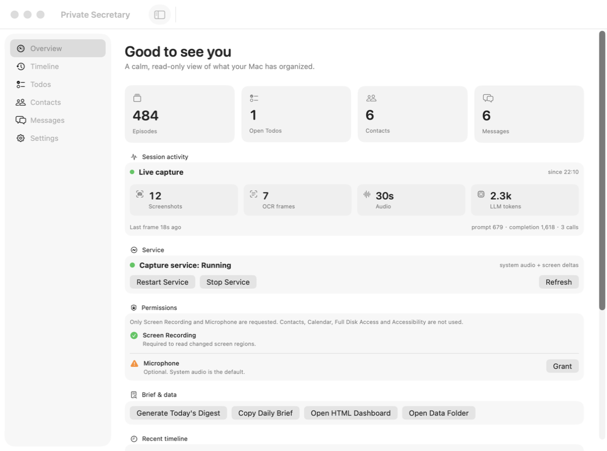

# 实时活动指标

Overview 首页新增 **Session activity** 卡片，每 2 秒读取轻量状态一次；Timeline / Messages 等重数据仍按 8 秒刷新。

显示内容：




| 指标 | 含义 |
|---|---|
| Screenshots | 本次 daemon 会话收到的有效屏幕帧数 |
| OCR frames | 实际完成 OCR 并产生候选的帧数 |
| Audio | 本次会话处理的音频秒数 |
| LLM tokens | 本地 LLM 累计 prompt + completion token |
| prompt / completion / calls | 模型输入/输出 token 与调用次数 |
| Last frame | 最近一次屏幕帧时间 |

## 数据来源

- Screenshots / OCR / Audio：`CaptureHealth` 通过 `run/capture-status.json` 发布；
- LLM token：`run/llm-usage.json`，由 `scripts/llm-bridge.py` 在每次 Ollama 调用后原子累加；
- 状态读取：`MemoryService.status()` 同时读取两者。

所有计数均在本机完成，不上传。

## LLM usage 文件

格式：

```json
{
  "prompt_tokens": 329,
  "completion_tokens": 227,
  "calls": 2,
  "updated_at": "2026-11-08T13:58:47.891055Z"
}
```

`intentGate.model` / `factGate.model` 的 `arguments` 需要带：

```json
["scripts/llm-bridge.py", "--usage", "/path/to/home/run/llm-usage.json"]
```

`scripts/install-local-llm.sh` 会自动写入这一参数。

## 说明

- Screenshots / OCR / Audio 是**当前 daemon 会话**计数，重启 daemon 后归零；
- LLM usage 文件是**持久累计**，用于观察本地模型使用量；
- 没有本地模型调用时 LLM 区域显示上次累计值；
- 屏幕帧只有通过去重/变化检测后才会进入 OCR，所以 OCR frames 小于 Screenshots。
