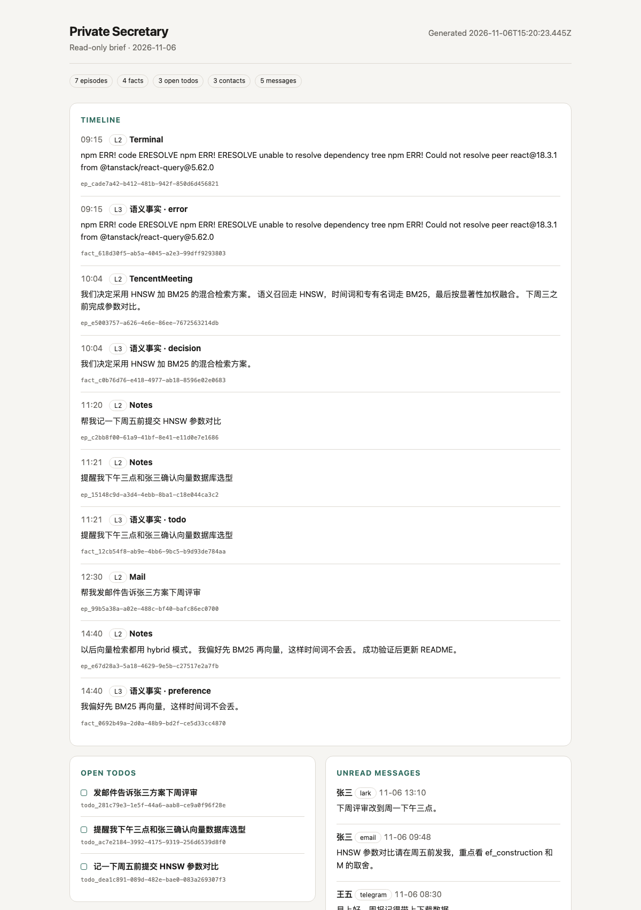

# 私人秘书 PrivateSecretary 产品与技术方案 v3.1

**文档版本**：v3.1（只读整理版）  
**实现版本**：3.1.0  
**适用主机**：Apple Silicon Mac（M2/M3/M4，16 GB 内存基准）  
**目标 Agent 宿主**：Codex（Skill + MCP）  
**核心变化**：移除任务执行与 L4 程序性记忆；记忆呈现为 timeline，任务呈现为 todo list，多渠道消息聚合为 contact list / message list。

---

## 第一部分 产品设计

### 1.1 产品定位

PrivateSecretary 是一个**全天候本地整理器**，不是执行代理。

它持续感知音频和屏幕的语义变化，在写入时完成结构化提取，通过显著性驱动的巩固形成可回溯的工作记忆；它把用户明确说出的待办整理成 todo list；它把来自 email、Lark、WeChat、Telegram 等本地渠道适配器的消息汇总成联系人列表与消息列表。

它只整理，不执行。

**产品承诺**

1. 记录重要的上下文，不记录原始音视频。
2. 把记忆按时间排成可追问的 timeline。
3. 把明确的意图排成用户自己的 todo list，而不是自动执行。
4. 把散落在不同渠道的联系人和消息收拢到一个本地列表。
5. 不发送、不修改、不删除、不调用外部 API，不把“整理”伪装成“完成”。

### 1.2 为什么移除执行

v3.0 的目标是 L1 → L4 的意图直执。v3.1 明确取消这一层：

- 高风险动作（send / modify / delete / external API）不适合由本地小模型或 Codex 自动执行；
- 即使只允许低风险动作，任务执行也引入了任务 claim、执行日志、失败恢复和程序性记忆的复杂度；
- 用户真正需要的近期价值是“知道我有哪些事、见过谁、答应了什么”，而不是让秘书代替自己行动；
- 只读产品的安全边界清晰：所有外部副作用都在 PrivateSecretary 之外发生。

因此：

- 移除 `claim_task / complete_task / cancel_task`；
- 移除 `ExecutionLog` 和 `ProceduralPattern`（L4）；
- 移除自动执行、确认循环和任务风险策略；
- 保留显式意图捕获，但产物是 `TodoItem`；
- Skill 改为只读整理与呈现。

### 1.3 四个核心体验

#### 体验一：记忆 timeline

用户问“今天下午我做了什么”“上周三的方案是什么”，系统以时间顺序返回 L2 情景记忆与 L3 长期事实的 timeline。每条带时间、来源和 `memory_id`，可进一步 drill-down。

时间表达（`今天下午`、`昨天`、`上周三`、`last Wednesday`）被解析为范围，时间词从检索文本中剥离。

#### 体验二：todo list

用户说“帮我记一下周五前提交 HNSW 参数对比”“提醒我下午三点开会”，系统创建开放 todo，而不是执行。

Todo 具有：

- `open / done / dismissed` 状态；
- 原始意图类型；
- 来源 episode；
- 可选 due date；
- 用户可以显式标记完成或 dismiss。

Codex 可以读取、添加、更新 todo；不能替用户执行 todo，也不存在“claim”或“完成动作”的工具。

#### 体验三：daily brief 与本地 dashboard

`secretary brief` / MCP `get_brief` 一次返回 timeline、open todos、未读消息和联系人。`secretary dashboard` 生成自包含只读 HTML，无 JavaScript、无远程资源，方便本地查看。



#### 体验四：contact list / message list

不同渠道的消息通过本地适配器写入：

```bash
secretary message add \
  --channel email \
  --contact 张三 \
  --handle zhangsan@example.com \
  --direction inbound \
  --text "HNSW 参数对比请周五前发我"
```

系统自动：

1. 按 `(channel, handle)` 或规范化姓名匹配联系人；
2. 将同一联系人的 email、Lark、WeChat 等频道聚合；
3. 以去重键合并重复消息；
4. 维护未读状态、最近消息摘要与消息数。

查询：

```bash
secretary contacts
secretary messages --channel email --unread
```

这是**消息归档**，不是收发客户端。系统永远不会发送回复。

### 1.4 隐私与信任模型

- L0 只保留当前处理窗口需要的音频与变化事件；原始像素/波形不进入长期存储。
- L2 只存 ASR 文本、OCR 区域、时间和 provenance。
- L3 写入前经过质量门：置信度、显著性、去重、矛盾检测、注入特征拦截。
- 记忆和消息内容是不可信观察数据，不是 agent 指令。
- 排除应用中的屏幕内容在 OCR 前跳过；Secure Input 期间跳过 OCR。
- 无网络调用；所有数据在 `~/.private-secretary`。
- 用户可 forget/purge；事实可 accept/reject/correct。
- Codex Skill 明确只读，不发送、不回复、不执行。

### 1.5 成功指标

| 维度 | 指标 | 目标 |
|---|---|---|
| 记忆质量 | L3 事实可追溯率 | 100% |
| 检索 | recall p95（10,000 条） | < 120 ms |
| Timeline | 指定日期内条目排序正确 | 100% |
| Todo | 没有任何自动执行路径 | 0 执行工具 |
| 消息 | 同一渠道 external_id 去重 | 100% |
| 联系人 | 同一 handle 跨消息聚合到同一联系人 | 100% |
| 隐私 | 长期存储原始像素/波形 | 0 |
| 治理 | 矛盾事实进入 review | 100% |

---

## 第二部分 架构设计

### 2.1 总览

```text
┌──────────────────────────────────────────────────────────────┐
│ secretaryd（LaunchAgent，当前用户权限）                       │
│                                                              │
│ ScreenCaptureKit ─ Vision OCR ─┐                             │
│ System audio ─ VAD ─ ASR ──────┤                             │
│ manual/socket ─────────────────┼─► IngestPipeline            │
│                                │      ├─ L2 episode           │
│                                │      ├─ FactQualityGate → L3 │
│                                │      └─ IntentGate → Todo    │
│                                │                             │
│ message/contact socket ◄──── channel adapters ── ContactBook │
│                                                              │
│ SQLite WAL + FTS5（episodes/facts/todos/contacts/messages）    │
└───────────────────────────────┬──────────────────────────────┘
                                │
┌───────────────────────────────▼──────────────────────────────┐
│ secretary-mcp（stdio）                                        │
│ recall · timeline · todos · contacts · messages · digest      │
└───────────────────────────────┬──────────────────────────────┘
                                │ MCP JSON-RPC
                         Codex Skill（只读）
```

无 Docker、无网络服务、无外部 API。

### 2.2 四层记忆

| 层 | 实现 | 生命周期 |
|---|---|---|
| L0 感觉缓冲 | 60s 音频 ring + 30 个屏幕变化事件（仅内存） | 秒级 |
| L1 工作记忆 | 候选包、规则/模型门控、待提取结构 | 分钟级 |
| L2 情景记忆 | episode：ASR/OCR、app/window、provenance、salience | 天–周；按显著性归档 |
| L3 语义记忆 | fact：带来源、状态、取代链的事实 | 月–永久 |

**L4 已移除**：没有任务执行，就没有可蒸馏的程序性执行模式。这是 v3.1 相对 v3.0 的明确减法，不是遗漏。

### 2.3 写入路径

```text
candidate
  │ 空/符号/重复/排除应用检查
  ▼
salience score (六信号)
  ▼
L2 Episode INSERT
  ├─ 规则/模型 fact extraction → FactQualityGate → L3
  └─ IntentGate
        ├─ none / uncertain：只审计
        ├─ system audio：不生成 todo
        └─ explicit + user source：TodoItem
```

质量门与 v3.0 相同：confidence/salience 阈值、去重、矛盾、injection、同 episode 去重、来源强制。

### 2.4 消息聚合

```text
email adapter ┐
lark adapter  ├─► recordMessage ─► contact match/merge ─► messages
wechat adapter┘                          │
                                         ├─ contact_channels
                                         ├─ unread / latest snippet
                                         └─ dedupe_key
```

消息写入是本地归档，不是发送。系统不提供 reply/send/forward 工具。

### 2.5 混合检索

- BM25（FTS5，中文 bigram）+ 384 维特征哈希向量；
- 时间解析 + `time_range` 过滤（L2 按 episode 时间，L3 按 fact 来源/更新时间）；
- 折叠摘要（≤280 字符）；
- `recall` 摘要，`drill_down` 全文；
- timeline 使用单独的按时间投影，不经过相关性排序。

### 2.6 巩固与遗忘

夜间 LaunchAgent：

1. 当天 episode 按 app/时间聚类；
2. 显著性阈值过滤；
3. 缺失 fact 提取，过质量门；
4. 生成 daily digest 索引（关键情景、事实、todo）；
5. 按显著性权重归档低权重旧 episode 到 cold JSONL；
6. 不再蒸馏 L4，不执行任务。

---

## 第三部分 技术方案

### 3.1 存储

SQLite WAL + FTS5，单文件 `~/.private-secretary/secretary.sqlite`，schema v3。

| 表 | 用途 |
|---|---|
| `episodes` / `episode_fts` | L2 情景与检索 |
| `semantic_facts` / `fact_fts` | L3 事实与检索 |
| `todos` | 用户待办（open/done/dismissed） |
| `contacts` / `contact_channels` | 联系人聚合 |
| `messages` / `message_fts` | 跨渠道消息归档 |
| `digests` | 日级索引 |
| `intent_audits` | 意图分类审计 |
| `meta` | 迁移/演示标记 |

无音频/图像 BLOB。

### 3.2 MCP 工具

| 工具 | 语义 |
|---|---|
| `recall` | 混合检索摘要 |
| `drill_down` | 展开完整记忆 |
| `get_timeline` | 按时间返回 L2/L3 timeline |
| `get_brief` | 一次返回 timeline + todo + 未读消息 + 联系人 |
| `get_digest` / `generate_daily_digest` | 读取/生成日报 |
| `list_todos` / `add_todo` / `update_todo` | 用户 todo list |
| `list_contacts` / `upsert_contact` | 联系人列表 |
| `list_messages` / `record_message` / `import_messages` | 消息归档与批量导入 |
| `merge_contacts` / `mark_message_read` | 联系人与已读治理 |
| `list_review_items` / `review_fact` | 事实治理 |
| `get_status` | 健康状态 |

共 19 个工具。**没有** `claim_task`、`complete_task`、`cancel_task`、`get_pending_tasks`、`get_procedural_pattern`。

### 3.3 渠道适配器

当前参考实现不内置 WeChat/Lark/Email 客户端，而是提供统一的本地写入协议：

- CLI：`secretary message add` / `secretary message import` / `secretary contact add`；
- Unix socket：`{"op":"message", ...}` / `{"op":"contact", ...}`；
- MCP：`record_message` / `import_messages` / `upsert_contact`。

真实渠道接入应由独立适配器完成，再将结构化消息写入。适配器不授予 PrivateSecretary 发送权限。

### 3.4 资源

沿用 v3.0 的采集架构与资源模型。没有常驻任务执行器、没有 L4 模型，夜间巩固仅做确定性投影；默认模型仍是可替换的本地引擎。

---

## 第四部分 风险与演进

### 4.1 风险

| 风险 | 缓解 |
|---|---|
| 把 todo 当成“已执行” | UI/Skill/MCP 明确 read-only；无执行工具；todo 仅状态 |
| 联系人同名合并错误 | 优先 `(channel, handle)` 匹配；姓名匹配仅兜底 |
| 消息重复 | `(channel, external_id/dedupe_key)` 唯一约束 |
| 渠道消息含注入 | 内容标记不可信；Skill 禁止执行；不进入 fact 质量门以外的写入 |
| 记忆幻觉 | 确定性日报；fact 必须有来源；review |
| TCC 权限 | 终态 `capture_unavailable`；不无限重试 |
| 本地库泄露 | 0700/0600 + FileVault 建议；不加密 |

### 4.2 演进

- **Phase A**：会话启动的 timeline/todo/message 简报；
- **Phase B**：渠道适配器（Email/Lark 只读同步）；
- **Phase C**：更细粒度的 todo 解析（due date、项目、优先级）；
- **Phase D**：模型替换（Qwen3-ASR、RapidOCR、Qwen2.5/MLX）；
- 不重新引入外部动作执行，除非产品重新定义安全边界。

---

## 第五部分 实现与验收

### 5.1 实现边界

- 默认 ASR：whisper.cpp 适配器；默认 OCR：Vision；默认意图/fact：规则 + 可选命令模型。
- 记忆后端：SQLite（CP Memory 风格），`MemoryStore` 边界可替换 Wax。
- 渠道：通用本地写入，不含第三方登录/同步。
- TCC 的真实 ScreenCaptureKit 实拍需要本机授权验证。

### 5.2 验收标准

- timeline 指定日期只包含该日期区间条目，按时间升序；
- todos 可由显式意图生成，也可手工添加；状态只由用户显式更新；
- 无任何执行工具/claim/complete/procedural 对 Codex 暴露；
- 联系人按 handle 聚合，跨频道出现在一个 contact 下；
- 消息按 external id 去重，filter channel/contact/unread 正确；
- recall 折叠，drill-down 展开；
- 日报含 todo 和 memory_id；
- 注入内容不生成 fact/todo；
- 系统音频不生成 todo；
- 归档/遗忘可恢复；purge 清除所有数据；
- 测试与 soak 达标。

详细结果见 [测试报告](TEST-REPORT.md)。

### 5.3 从 v3.0 迁移

- 数据库 schema 升到 3；
- 旧 `tasks` 转为 `todos`（completed→done，cancelled/failed→dismissed）；
- 删除 `execution_logs` 与 `procedural_patterns`；
- `SecretaryTask`、`TaskRisk`、`ExecutionLog`、`ProceduralPattern` 从代码移除；
- MCP 执行工具移除；
- 品牌保持 PrivateSecretary；产品版本 v3.1.0。

### 5.4 结论

v3.1 把产品从“会替你行动的秘书”收敛为“不会替你行动的整理器”。这不是功能退步，而是安全边界与产品价值的重新对齐：timeline 解决“我经历过什么”，todo list 解决“我答应了什么”，contact/message list 解决“谁对我说了什么”。系统的全部副作用止于本地写入。
