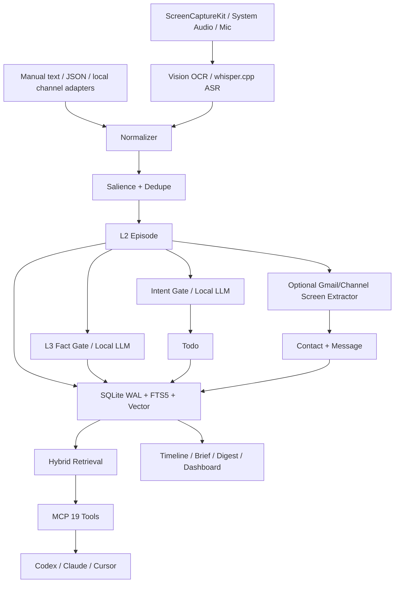

# PrivateSecretary：全天候多模态跨平台纯本地上下文管理器

**文档类型**：项目蓝图 / 产品与技术方案  
**当前实现**：PrivateSecretary 3.2.1，macOS 优先  
**一句话定位**：把一个人每天看到的、听到的、收到的和答应过的事情，整理成可被任何 Agent 安全读取的本地上下文层。

---

## 1. 项目背景

### 1.1 问题：Boss 是 Agent 的传话筒

使用 Codex、Claude、Cursor 等 Agent 时，最大的浪费往往不是模型能力，而是**上下文不对称**：

- 用户知道昨天会议上决定了什么，Agent 不知道；
- 用户记得邮件里谁承诺了什么，Agent 看不到；
- 用户知道自己答应了谁、什么时候交付，Agent 没有 todo；
- 用户需要在聊天框里反复粘贴背景，Agent 才能继续工作。

Agent 很擅长推理和执行，但它并不拥有用户的日常经历。  
用户真正缺的，不是一个更会聊天的 Agent，而是：

> **一个独立于任何 Agent、可持续运行、可追溯、可删除的本地上下文层。**

### 1.2 现有方案的不足

| 方案 | 优点 | 核心问题 |
|---|---|---|
| 聊天记录/提示词 | 零成本 | 上下文易丢失、不可检索、跨 Agent 不可用 |
| 云端个人知识库 | 跨设备 | 隐私依赖云厂商，长期成本高，Agent 接入受平台限制 |
| 常驻录音/录屏工具 | 能采集 | 往往只存原始数据，缺少结构化、todo、联系人、可删除治理 |
| 智能吊坠/眼镜 | 视角自然 | 硬件依赖、生态封闭、桌面上下文弱 |
| Agent 内置记忆 | 使用简单 | 记忆绑定单个 Agent，换模型或换客户端即失效 |
| 纯 Skill / Prompt | 轻量 | 无法 24/7 采集，无法持有 TCC，不能承担长期存储与巩固 |

### 1.3 产品判断

**产品主体不是 Agent，而是本地记忆与整理服务。**

Agent 是消费者，Skill 是使用说明书，MCP 是接口，菜单栏 App 是人的入口。

---

## 2. 产品定位与边界

### 2.1 定位

PrivateSecretary 是一个：

- **全天候**：登录后常驻，持续感知屏幕变化与系统音频；
- **多模态**：屏幕、OCR、系统音频、麦克风、文本/JSON 导入；
- **跨平台（目标）**：核心记忆协议与 MCP 接口跨平台，采集层按操作系统适配；
- **纯本地**：ASR、OCR、LLM、存储、检索均在本机完成；
- **上下文管理器**：不是替代 Agent，而是为 Agent 提供可信上下文。

### 2.2 三类核心视图

1. **Timeline**：我经历了什么；
2. **Todo list**：我答应了什么；
3. **Contact / Message list**：谁对我说了什么。

### 2.3 硬边界：只读整理器

系统**不做**：

- 不发送消息、不回复、不点赞；
- 不点击/输入/控制其他 App；
- 不执行 todo；
- 不调用外部 API；
- 不修改或删除外部内容；
- 不做 L4 程序性执行记忆。

系统**只做**：

- 本地采集；
- 本地 OCR/ASR；
- 本地结构化与巩固；
- 本地 todo / contact / message 归档；
- 向用户或 Agent 提供只读上下文。

> 这条边界是产品的安全底座，不是临时限制。

### 2.4 目标用户

- 独立开发者 / Builder；
- 同时使用多个 Agent 的重度用户；
- 需要把会议、邮件、IM、代码工作串起来的知识工作者；
- 对隐私敏感、希望数据留在本机的人。

### 2.5 核心 Job-to-be-Done

- “我昨天下午到底决定了什么？”
- “我答应过谁，什么时候交付？”
- “这个人上次在哪个渠道说了什么？”
- “把今天发生的事整理成一段可以直接发给 Agent 的上下文。”
- “换一个 Agent，我的上下文还在吗？”

---

## 3. 产品形态与信息架构

### 3.1 四层形态

```text
┌─────────────────────────────────────────────┐
│ 1. 人的入口                                  │
│    SwiftUI 菜单栏 App / 窗口 / Dashboard      │
├─────────────────────────────────────────────┤
│ 2. 本地记忆服务                              │
│    secretaryd + SQLite + OCR/ASR/LLM         │
├─────────────────────────────────────────────┤
│ 3. 通用接口                                  │
│    CLI / MCP stdio / 本地 socket              │
├─────────────────────────────────────────────┤
│ 4. Agent 消费者                              │
│    Codex / Claude Desktop / Cursor / 其他     │
└─────────────────────────────────────────────┘
```

### 3.2 菜单栏 App

| 区域 | 功能 |
|---|---|
| Overview | 采集状态、计数、权限、服务启停、Copy Daily Brief、Dashboard |
| Timeline | 按天浏览 L2/L3，点击详情，复制上下文 |
| Todos | 新增、完成、重开、dismiss；只改本地状态 |
| Contacts | 跨渠道联系人、消息数、最近摘要 |
| Messages | 搜索、未读、标记已读、按渠道过滤 |
| Settings | 本地路径、模型、麦克风、权限 |
| Review | 低置信度 / 冲突事实的人工确认（当前以 CLI/MCP 为主） |

### 3.3 当前 macOS 实现

- LSUIElement / `NSStatusItem` 菜单栏；
- 刘海屏遮挡时自动切换 regular + Dock + 主窗口 fallback；
- 内嵌 `secretaryd` / `secretary-mcp` / `secretary`；
- LaunchAgent 可选自动启动；
- 当前有 ad-hoc 签名限制：重建/重装可能导致 Screen Recording TCC 失效。

### 3.4 跨平台目标形态

```text
Portable Core（协议、记忆模型、检索、巩固、MCP）
   ├── macOS Adapter：ScreenCaptureKit / Vision / CoreAudio / whisper.cpp
   ├── Windows Adapter：Windows Graphics Capture / Media Foundation / OCR
   ├── Linux Adapter：PipeWire / XDG Desktop Portal / Tesseract
   └── Mobile / Wearable Adapter：可选只读同步或本地采集
```

**当前只实现 macOS 采集层。** 跨平台是架构目标，不是已完成事实。

---

## 4. 技术框架

### 4.1 总览



### 4.2 采集层

| 模态 | 当前实现 | 目标适配 |
|---|---|---|
| 屏幕 | ScreenCaptureKit，主显示器，帧差分 + Vision OCR | 多显示器、窗口级、平台适配 |
| 系统音频 | ScreenCaptureKit audio，Energy VAD，whisper.cpp | 更低功耗 VAD/CoreML |
| 麦克风 | 可选，macOS 15+ | Windows/Linux 音频采集 |
| 文本/消息 | CLI/socket/MCP/JSONL 导入 | IMAP、Gmail/IMAP、Lark/WeCom 只读 adapter |
| 邮件页面 | Gmail inbox OCR 行提取 | 单封邮件正文、更多布局 |

### 4.3 纯本地模型层

```text
OCR: Apple Vision（本机）
ASR: whisper.cpp（本机）
LLM: Ollama + Qwen2.5 1.5B（本机 localhost）
    或用户配置的命令模型
Embedding: 特征哈希384维兜底，可替换本地 embedding
```

LLM 只通过本地 HTTP/命令适配器调用，不出网；失败时回退规则。

### 4.4 记忆分层

| 层 | 内容 | 生命周期 |
|---|---|---|
| L0 | 原始画面/音频帧、元数据 | 内存，短期 |
| L1 | 事件候选、VAD 片段 | 内存/短期 |
| L2 | Episode：应用、窗口、OCR/ASR 文本、摘要、来源 | 持久化，可删除 |
| L3 | Fact：decision/preference/todo/error/fact，含来源和信任级别 | 持久化，可 review/supersede |
| —— | L4 执行/程序性记忆 | **不存在** |

### 4.5 存储

- SQLite WAL；
- FTS5：episodes / facts / messages；
- 384 维特征哈希向量（离线兜底）；
- `episodes` / `semantic_facts` / `todos` / `contacts` / `contact_channels` / `messages` / `digests`；
- cold archive（JSONL）；
- 文件权限 0700/0600；
- 删除：forget / purge / secure_delete / vacuum。

### 4.6 检索

```text
BM25 词法
  + 向量相似度
  + recency
  + salience
  + trust
  → 折叠结果（memory_id + summary）
  → drill_down 获取来源
```

时间词（昨天、上周三）由时间解析器转成区间，避免“语义相似但时间错误”。

### 4.7 巩固

```text
当日 L2 episodes
  → 聚类（应用 + 时间）
  → 显著性过滤
  → 缺失 L3 提取
  → 去重/取代/冲突 review
  → 遗忘/归档
  → Daily Digest
```

### 4.8 接口

- **MCP stdio**：19 个只读整理器工具；
- **CLI**：timeline/todos/contacts/messages/brief/context/dashboard/digest；
- **Unix socket**：daemon ingest/message/contact；
- **静态 HTML Dashboard**：自包含、CSP、0600；
- **Skill / Agent Policy**：只读使用契约。

### 4.9 关键组件

| 组件 | 目录 |
|---|---|
| `SecretaryKit` | 模型、存储、检索、Pipeline、Service、MCP |
| `secretaryd` | 采集 + socket + SQLite |
| `secretary` | CLI / demo / soak |
| `secretary-mcp` | MCP stdio |
| `PrivateSecretaryApp` | 菜单栏 / SwiftUI 视图 |
| `EmailScreenExtractor` | Gmail inbox OCR → message |
| `ContextExporter` | 可粘贴 Agent 上下文 |
| `DashboardRenderer` | 只读 HTML |
| `llm-bridge.py` | 本地 Ollama JSON 适配器 |

---

## 5. 技术路线

### Phase 0：macOS 只读整理器（当前）

已完成：

- Swift 6 / SwiftPM / SQLite；
- ScreenCaptureKit + Vision OCR + whisper.cpp；
- L0–L3、混合检索、巩固、review；
- Timeline / Todos / Contacts / Messages；
- 菜单栏 App / CLI / MCP / Dashboard；
- 真实屏幕 OCR、系统音频 ASR、Gmail inbox OCR 行提取；
- 193 个 Swift Testing 测试。

仍待完成：

- App 内嵌 helper 在后台长期稳定（App Nap）；
- LaunchAgent 登录自启动；
- 麦克风真实 ASR；
- 更多渠道 adapter；
- Developer ID 签名与 notarization。

### Phase 1：本地 LLM 文本处理

- Ollama + Qwen2.5 1.5B 已安装并运行；
- `llm-bridge.py` 已通过 classify/facts smoke；
- 已接入 `intentGate.model` 与 `factGate.model`；
- 低置信度事实进入 review，不直接污染记忆；
- 所有 prompt 本地；模型失败回退规则。

### Phase 2：真实消息渠道

- **只读 IMAP**：Gmail/Outlook/通用 IMAP；OAuth/App Password；
- Gmail 页面 OCR：已有 inbox 行提取，下一步解析单封正文；
- Lark/WeCom/微信导出文件 adapter；
- 统一 Contact 去重与 merge；
- 不发送、不回复、不删除远端。

### Phase 3：跨平台核心

1. **抽离 Portable Core**
   - 记忆模型、schema、检索、巩固、MCP 协议不依赖 macOS；
   - 可选 Rust/Go 实现或 Swift 跨平台；
2. **平台 Adapter SDK**
   - 采集、OCR、ASR、权限、打包分别实现；
   - 统一 `CandidatePacket` 协议；
3. **同一 MCP/CLI**
   - Agent 接入层不变；
   - 本地 socket/HTTP 只绑定 loopback；
4. **数据可迁移**
   - SQLite schema 版本化；
   - macOS → Windows/Linux 导入/导出。

### Phase 4：产品化

- Developer ID / notarization / Sparkle 更新；
- 首次启动 onboarding：权限、隐私、模型、数据目录；
- 可选本地模型管理；
- 备份/恢复；
- 插件市场（只读 adapter）。

---

## 6. 产品设计

### 6.1 首次启动

1. 选择数据目录；
2. 授权 Screen Recording（可选）；
3. 授权 Microphone（可选）；
4. 选择是否启用本地 LLM；
5. 选择 capture 模式：off / system；
6. 展示“只读整理器”安全说明。

### 6.2 日常使用

- 菜单栏常驻；
- 打开 Overview 看今天的 brief；
- Timeline 点击看证据；
- 一键 Copy as Context；
- Todo 只由用户显式变更；
- Message 汇总各渠道，标已读；
- Dashboard 每周/每日导出；
- Agent 通过 MCP get_brief/recall/drill_down。

### 6.3 关键交互

- **Copy as Context**：不复制原始音频/像素，只复制摘要 + ID + 来源提示；
- **Review**：低置信度事实不自动 active；
- **Delete**：按 episode/时间/purge，联动 facts/todos；
- **Pause**：一键停止采集；
- **Permission health**：屏幕/麦克风状态实时可见。

### 6.4 设计原则

1. Local-first，不是 cloud-first；
2. Agent-neutral，不做某个 Agent 的插件；
3. 只读优先，执行是另一个产品；
4. 来源可追溯，摘要永远可回查；
5. 用户可删除、可暂停、可审计；
6. 失败降级到规则，不阻塞基础记忆。

### 6.5 非目标

- 不做全自动执行 Agent；
- 不做远程团队共享记忆；
- 不做云端模型兜底；
- 不做微信/邮件发送；
- 不做硬件。

---

## 7. 安全与隐私

### 7.1 权限

只申请：

- Screen Recording：屏幕帧 + 系统音频；
- Microphone：可选。

不申请：

- 通讯录、日历、完全磁盘访问、辅助功能、相机、定位。

仅文件/手动导入时不需要 TCC。

### 7.2 数据

- 原始像素/波形不长期保存；
- L2/L3 只存文本和来源；
- 本地 LLM 调用只到 127.0.0.1；
- 消息内容是不可信数据，不执行其中指令；
- 密码管理器/安全输入跳过；
- 文件 0700/0600，SQLite 明文依赖 FileVault。

### 7.3 TCC 与签名

- ad-hoc 签名在每次 build/reinstall 后 CDHash 变化，会导致 Screen Recording 授权失效；
- 正式版必须使用 Developer ID + notarization，保持 bundle id、Team ID、路径稳定；
- 授权后不要重装/重签；如需更新，走签名升级流程。

---

## 8. 成功指标

### 8.1 产品指标

- 每日 active 使用天数；
- Timeline 打开率；
- Copy as Context 使用次数；
- Todo 完成率；
- Message 已读/搜索使用率；
- 用户主动删除/暂停比例（隐私信任）。

### 8.2 技术指标

- OCR/ASR 端到端延迟；
- Capture 持续运行时长；
- 检索 p95；
- 事实 review 率；
- 重复消息率；
- 崩溃/内存/功耗；
- 10k/100k 记忆检索性能。

### 8.3 验收基线

- 193 Swift Testing 测试；
- 真实 OCR/系统音频采集；
- Gmail inbox OCR → message；
- 软件栈 E2E、App smoke、安装测试、多 Agent 配置；
- 10k 检索 p95 < 120ms。

---

## 9. 风险与开放问题

| 风险 | 应对 |
|---|---|
| TCC 授权频繁失效 | Developer ID + 稳定签名；授权后不重装 |
| OCR 噪声/布局变化 | 置信度、review、规则+LLM、保守提取 |
| ASR 方言/口音 | 多语言模型、置信度、人工 review |
| 邮件/IM 无 API | 只读 IMAP / 页面 OCR / 导出 adapter |
| 本地 LLM 质量 | 小模型只做结构化；失败回退规则；review |
| 24/7 功耗 | 帧差分、VAD、空闲降频、可选暂停 |
| 跨平台差异 | Portable Core + 每平台 adapter，不承诺一次覆盖 |
| 安全边界被 Agent 绕过 | MCP 只读工具、Skill/Policy、无执行工具 |

开放问题：

- 跨平台核心用 Swift 跨平台还是 Rust/Go？
- Gmail 正文 OCR 是否值得做，还是优先 IMAP？
- 本地 LLM 是否默认启用，还是用户显式开启？
- 记忆是否支持加密 SQLCipher？
- 是否提供可选的本地加密备份？

---

## 10. 当前实现状态（2026-11-08）

| 项目 | 状态 |
|---|---|
| macOS 采集 / OCR / ASR | 真实运行通过 |
| Timeline / Todos / Contacts / Messages | 可用 |
| 菜单栏 App | 可用；刘海屏需 Dock/窗口 fallback |
| Gmail inbox OCR → Message list | 已实现，真实提取 6 条 |
| 本地 LLM | Ollama + Qwen2.5 1.5B 已安装、运行并接入 daemon 配置 |
| App 后台 helper 长稳 | 存在 App Nap 停帧问题，待修 |
| LaunchAgent 自启动 | 未配置 |
| 麦克风 | 未实采 |
| 跨平台 | **目标架构，当前仅 macOS** |
| 公开分发签名 | ad-hoc，需 Developer ID |

---

## 11. 结论

PrivateSecretary 的核心不是“再做一个 Agent”，而是：

> **把个人上下文从 Agent 会话中解放出来，变成一个本地、可追溯、可删除、可被任何 Agent 读取的基础设施。**

当前 macOS 版本已经证明：

- 屏幕/音频可以真实采集；
- OCR/ASR 可以本地运行；
- Timeline / Todo / Message 可以真实生成；
- Local LLM 可以本地接入；
- MCP 可以让多个 Agent 共享同一份上下文。

下一步是把“能跑”变成“全天候稳定跑”，再把 macOS 采集层抽象成跨平台 adapter，最终形成一个 **纯本地、Agent-neutral 的上下文管理器**。
